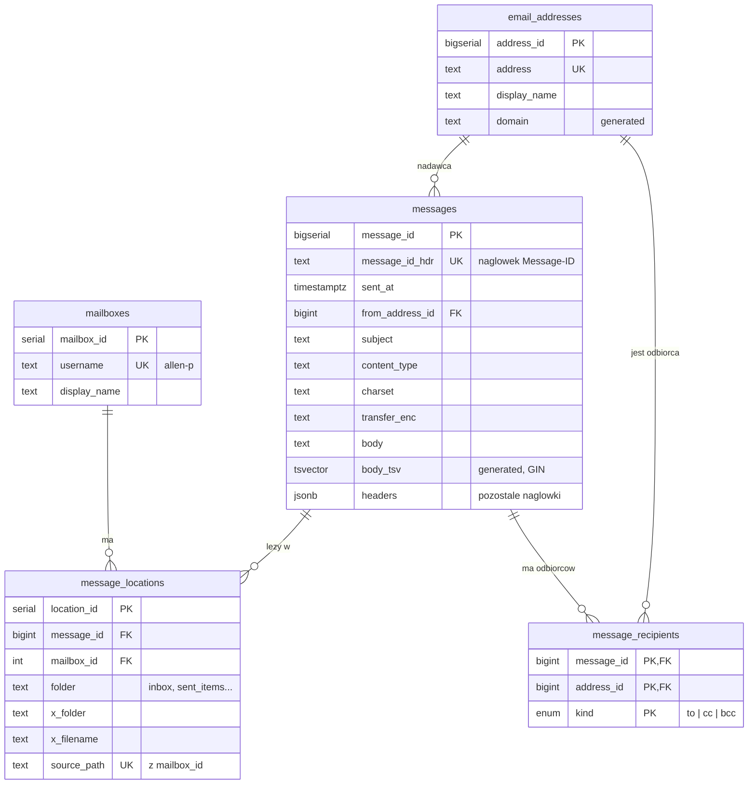

# Serwer przetwarzania danych Enron – dokumentacja projektu

**Projekt grupowy - Zarządzanie danymi**

## Zespół

| Rola | Imię i nazwisko |
|---|---|
| Aplikacja / zastępca roli sysadmina | Maciej Górski |
| Bazy danych / zastępca roli security | Wiktor Langier |
| Sysadmin / zastępca roli od aplikacji | Kacper Łęgocki |
| Bezpieczeństwo / zastępca roli bazo danowca | Kacper Janowicz |

---

## 1. Wstęp

Celem projektu jest stworzenie serwera z bazą danych do przechowywania i przetwarzania zbioru **Enron Email Dataset**, czyli publicznie dostępnej skrzynki pocztowej firmy Enron, zawierającej setki tysięcy wiadomości wraz z metadanymi (nadawca, odbiorcy, data, temat, treść).

Projekt obejmuje przygotowanie infrastruktury, uruchomienie i konfigurację bazy danych, import danych oraz zabezpieczenie całego środowiska.

---

## 2. Zakup serwera VPS

Obecnie jesteśmy na etapie zakupu i przygotowania serwera. Zdecydowaliśmy się na VPS w **OVHcloud** o następujących parametrach:

| Parametr | Wartość |
|---|---|
| Procesor | 2 vCores |
| Pamięć RAM | 4 GB |
| Dysk | 40 GB SSD NVMe |
| Kopie zapasowe | Codzienny backup z ostatnich 24 godzin |
| Transfer | Nielimitowany |
| Przepustowość do sieci publicznej | 500 Mbps |

---

## 3. Konfiguracja użytkowników i grup systemowych

W celu zachowania zasady najmniejszego uprzywilejowania (*Least Privilege*) zrezygnowano z korzystania z domyślnego konta głównego do codziennej pracy. Utworzono dedykowane grupy oraz konta użytkowników odzwierciedlające podział ról w zespole:

* **Grupy:** Utworzono grupy odpowiadające rolom w zespole: `sec_team`, `sys_team`, `db_team` i `dev_team`.
* **Konta robocze ról:** Utworzono m.in. użytkownika `developer` oraz konta dla administratorów (`sys_admin`) i administratorów baz danych (`database`).
* **Użytkownik powiązany z rolą bezpieczeństwa:** Przyporządkowano użytkowników do odpowiadających im ról. `security` przypisany do grupy `sec_team`.
* **Zasada zastępstwa:** W szczególnych, uzasadnionych przypadkach członkowie zespołu mogą przejmować uprawnienia powiązanych ról zastępczych przy użyciu mechanizmu `sudo`.

---

## 4. Hardening i Bezpieczeństwo Systemu (Rocky Linux)

W celu zabezpieczenia infrastruktury przed nieautoryzowanym dostępem oraz automatycznymi atakami botów z internetu (brute-force), wdrożono następujące mechanizmy hardeningu:

### 4.1. SELinux (Security-Enhanced Linux)
System operacyjny bazuje na dystrybucji **Rocky Linux** z domyślnie włączonym mechanizmem **SELinux** działającym w trybie rygorystycznym:
* **Stan:** `Enforcing` (weryfikowany poleceniem `sestatus`). Zapewnia to obligatoryjną kontrolę dostępu (MAC) jako dodatkową warstwę izolacji procesów i usług.

### 4.2. Zabezpieczenie i zmiana konfiguracji usługi SSH
* **Blokada logowania root:** W pliku `/etc/ssh/sshd_config` ustawiono parametr `PermitRootLogin no`. Uniemożliwia to bezpośredni dostęp administratora przez sieć, wymuszając logowanie na konta dedykowane.
* **Zmiana portu nasłuchu:** Przeniesiono usługę SSH z domyślnego portu `22` na niestandardowy port **`6767`**.
* **Integracja z SELinux i Firewalld:** 
  * Dodano port do polityki SELinux dla usługi SSH (`ssh_port_t`).
  * Zainstalowano i skonfigurowano zaporę sieciową `firewalld`, otwierając ruch TCP na porcie `6767`.

### 4.3. Monitorowanie i automatyczne aktualizacje
* **Logi systemowe:** Monitorowanie zdarzeń bezpieczeństwa realizowane jest za pomocą dziennika systemowego (`journalctl`) oraz logów autoryzacji w `/var/log/secure`.
* **Aktualizacje paczek:** Skonfigurowano automatyczne sprawdzanie i pobieranie aktualizacji bezpieczeństwa za pomocą pakietu `dnf-automatic.timer`.

### 4.4. Zarządzanie uprawnieniami zastępczymi (Sudoers)
W celu ograniczenia dostępu do konta `root`, skonfigurowano precyzyjne reguły w katalogu `/etc/sudoers.d/`. Członkowie zespołu mogą przejmować wyłącznie uprawnienia ról, dla których są przypisanymi zastępcami (np. konto `security` może przełączyć się na `database`).

### 4.5. Zabezpieczenie logów systemowych
Prawo odczytu kluczowych logów autoryzacji i zdarzeń (takich jak `/var/log/secure` oraz `/var/log/messages`) zostało odebrane "innym" użytkownikom i przypisane na wyłączność członkom grupy bezpieczeństwa `sec_team`.

### 4.6. Polityka haseł i ochrona przed atakami
* **Polityka haseł:** Za pomocą modułu `pam_pwquality` wymuszono stosowanie silnych haseł o minimalnej długości 12 znaków, składających się z co najmniej 3 różnych klas znaków (duże litery, małe litery, cyfry).
* **Fail2ban:** Zainstalowano i skonfigurowano usługę monitorującą dzienniki systemowe, która automatycznie blokuje adresy IP na zaporze sieciowej po wykryciu prób ataków typu brute-force na niestandardowy port SSH (6767).

---

## 5. Weryfikacja i Testy Zabezpieczeń

Podczas testów symulujących ruch z zewnątrz potwierdzono poprawność działania wdrożonych mechanizmów obronnych:
1. Próby nieautoryzowanego logowania na konto `root` spotykają się z natychmiastowym odrzuceniem połączenia przez demon SSH.
2. Dziennik systemowy poprawnie rejestruje udane uwierzytelnienia na dedykowanych kontach ról (np. `developer`), co gwarantuje pełną audytowalność działań w systemie.

## 6. Baza danych (PostgreSQL)

Dane z Enron Email Dataset trafiają do bazy **PostgreSQL**. Zbiór ma układ `użytkownik/folder/plik`, a każdy plik to jedna wiadomość w formacie RFC 822 (nagłówki, pusta linia, treść). Schemat jest znormalizowany, żeby nie powielać tych samych danych setki tysięcy razy.

### 6.1. Struktura

Baza składa się z pięciu tabel:

| Tabela | Co przechowuje |
|---|---|
| `mailboxes` | Właściciele skrzynek (ok. 150 osób, np. `allen-p`). |
| `email_addresses` | Każdy unikalny adres e-mail zapisany raz, małymi literami, wraz z domeną. |
| `messages` | Unikalne wiadomości: `Message-ID`, data, nadawca, temat, Content-Type, treść i pozostałe nagłówki. |
| `message_recipients` | Odbiorcy wiadomości z rozróżnieniem To / Cc / Bcc. |
| `message_locations` | Gdzie leży każda kopia wiadomości: skrzynka, folder i ścieżka pliku źródłowego. |

Diagram relacji (klucze główne `PK`, obce `FK`, unikalne `UK`):

### 6.2. Najważniejsze decyzje projektowe

* **Wiadomość oddzielona od lokalizacji.** Ta sama wiadomość leży w wielu skrzynkach i folderach. Treść zapisujemy raz (`messages`), a każde miejsce jej występowania osobno (`message_locations`). Oszczędza to miejsce i pozwala liczyć statystyki bez duplikatów.
* **Adresy w osobnej tabeli.** Ten sam adres powtarza się masowo, więc trzymamy go raz i odwołujemy się do niego przez numer. Ułatwia to też analizę, kto z kim korespondował.
* **Odbiorcy w tabeli łączącej.** Wiadomość ma wielu odbiorców, a adres może być odbiorcą wielu wiadomości.
* **Pozostałe nagłówki w `JSONB`.** Rzadko używane nagłówki (`X-*` itp.) nie zaśmiecają schematu, a nadal można je przeszukiwać.
* **Wyszukiwanie pełnotekstowe** po temacie i treści oraz indeks do szukania fragmentów tematu.
* **Data jako `TIMESTAMPTZ`**, bo nagłówek `Date` zawiera strefę czasową.
